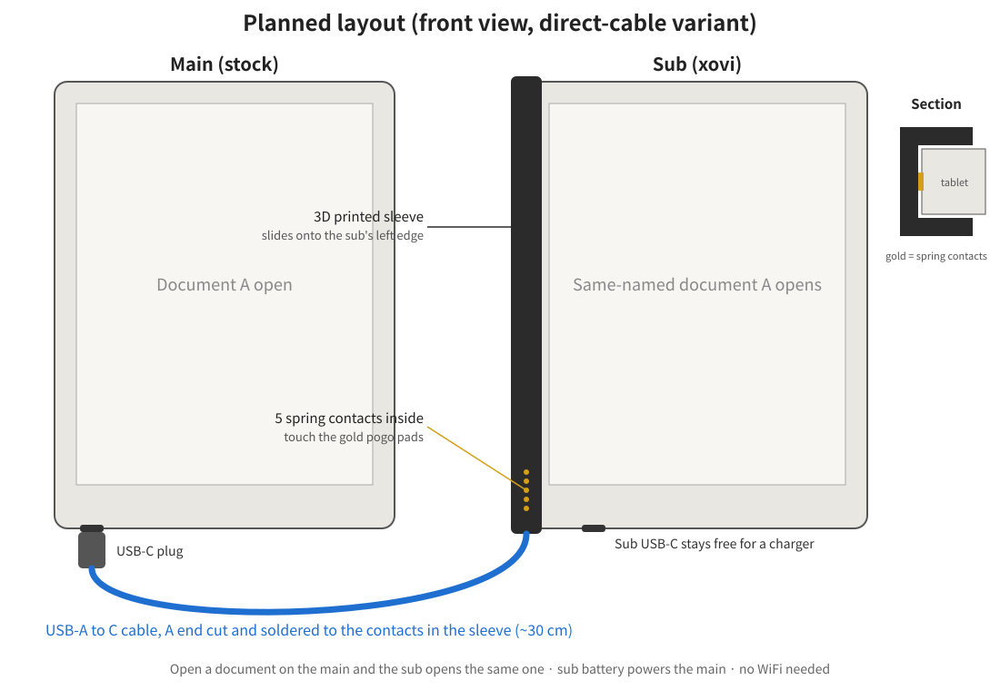

# Pogo to USB adapter (planned)

Hardware: [veryapt/remarkable-2-pogo-to-usb-adapter](https://github.com/veryapt/remarkable-2-pogo-to-usb-adapter)
(CERN-OHL-S v2). Gerbers and case STLs are in that repository; they are not copied here.

A printed sleeve slides onto the sub's left edge, spring contacts touch the pogo pads, and
a cable goes to the main's USB-C. The sub's own USB-C stays free for a charger.

## Parts (original design)

| Part | Qty | Notes |
|---|---|---|
| PCB (veryapt gerbers) | 1 | 2 layers, 1.6 mm, 8.9 x 41.9 mm |
| Case top / bottom | 1 set | 3D printed with supports, in the orientation of the STLs |
| Mill-Max 829-22-005-20-002101 | 1 | 5-pin right-angle spring pogo strip |
| Adafruit 4090 | 1 | USB-C breakout (downstream) |
| M2x8 countersunk screws | 4 | |
| 4x2 mm magnets | 2 | optional |
| USB-C to USB-C cable (USB 2.0 is enough) | 1 | to the main |

Assembly notes from the original: pogo strip and breakout go on opposite sides of the
PCB facing the same way; solder the breakout with the supplied header pins as spacers.

## Simpler variant (idea)

Skip the PCB and breakout: cut a USB-A to USB-C data cable, keep the USB-C plug (it
carries the 56 kΩ pull-up the main needs to see a power source) and solder its wires
straight to the pogo strip: red VBUS, white D-, green D+, black GND (ID unconnected).
Needs a modified case with a cable exit and strain relief.

## Bring-up checklist

1. Fit the adapter alone and check the contacts line up.
2. `dualrm-pogo.sh vbus on`, connect the main: the main should show charging and appear
   on the sub's pogo bus (`dualrm-pogo.sh status`).
3. Charger on the sub's USB-C while powering the main from the pogo pins.
4. WiFi off, open a document on the main.
